# Pokédex — Proyecto final de Programación VI

Aplicación móvil desarrollada con **Ionic + Angular** que consume la API pública **PokéAPI**. Permite explorar la Pokédex por generaciones, armar equipos al estilo de Pokémon Showdown y jugar una trivia con ruleta para ganar fichas shiny. La app está disponible en **español e inglés**.

## Autor

- Mateo Sebastián Rojas Cáceres

## Funcionalidades

### Pokédex
- Todos los Pokémon por número de Pokédex, separados por generación (I a IX).
- Buscador por nombre o número y carga progresiva con scroll infinito.
- Detalle de cada Pokémon: imagen oficial, tipos, altura, peso, stats base, debilidades, resistencias e inmunidades (calculadas para combinaciones de dos tipos).

### Equipo
- Varios equipos guardados en el dispositivo, de hasta 6 Pokémon cada uno.
- Editor de cada Pokémon: nivel (1-100), naturaleza, 4 ataques (solo los que puede aprender), EVs (máximo 252 por stat y 510 en total) e IVs (0-31).
- Resumen de debilidades del equipo por tipo.
- Exportación en formato **Pokémon Showdown** con botón de copiar (siempre en inglés para que Showdown la pueda importar) y versión traducida al español.

### Trivia
- Rondas de 10 preguntas en tres dificultades.
- Antes de cada pregunta se gira una ruleta que elige la categoría: *¿Quién es ese Pokémon?* (silueta), *Tipos* o *Generación*.
- Las preguntas se generan con datos de PokéAPI.
- Si se responden las 10 bien se ganan **fichas shiny**, que permiten activar la versión shiny de un Pokémon en los equipos.

### Idiomas
- Al abrir la app por primera vez se elige el idioma (español o inglés); se puede cambiar desde la Pokédex.

## Fuente de datos

- **PokéAPI** — https://pokeapi.co (formato JSON)
  - `/generation/{n}`: Pokémon de cada generación
  - `/pokemon-species?limit=2000`: lista completa de Pokémon
  - `/pokemon/{id}`: detalle, stats y ataques que puede aprender
  - `/type/{tipo}`: tabla de efectividad entre tipos
- **Sprites de PokéAPI** — https://github.com/PokeAPI/sprites (imágenes normales y shiny)
- **Archivos locales** `src/assets/data/nombres-es.json` y `nombres-en.json`: nombres de tipos, naturalezas y ataques en español e inglés, generados desde PokéAPI con el script `scripts/generar-nombres.mjs`.

Las URLs están definidas en `src/environments/`.

## Tecnologías

- Ionic 9 (`provideIonicAngular`, componentes importados individualmente)
- Angular 22 con NgModules y la sintaxis de control de flujo `@if` / `@for` / `@switch`
- TypeScript y RxJS
- Capacitor 8 (plataforma Android)
- `localStorage` para guardar equipos, idioma y fichas shiny

## Cómo ejecutarlo

Requisitos: **Node.js 22 o superior** e **Ionic CLI** (`npm install -g @ionic/cli`).

### En el navegador

```bash
git clone https://github.com/mattt77/Tp_Programaci-nVI.git
cd Tp_Programaci-nVI
npm install
ionic serve
```

La app se abre en `http://localhost:8100`. Para verla como en un celular, usá la vista de dispositivo de las herramientas de desarrollador del navegador (F12 → Ctrl + Shift + M).

### En Android

Requisito adicional: **Android Studio**.

```bash
npm run build
npx cap sync android
npx cap open android
```

En Android Studio, elegí un emulador o un celular conectado y tocá **Run ▶**.

> La ruta de la carpeta del proyecto no debe tener tildes ni caracteres especiales, porque Android Gradle no los admite en Windows.

También podés instalar directamente el APK de debug desde la sección **Releases** del repositorio.

### Compilar para producción

```bash
npm run build
```

### Regenerar los nombres traducidos (opcional)

```bash
node scripts/generar-nombres.mjs
```

## Estructura del proyecto

```
src/app/
├── components/      # Modales: detalle, selector de Pokémon, editor de Pokémon, exportar
├── i18n/            # Textos de la interfaz en español e inglés
├── models/          # Interfaces y constantes (Pokémon, equipo, trivia)
├── pipes/           # Pipe "t" para traducir textos
├── services/        # Servicios: PokéAPI, nombres, tipos, equipos, idioma, Showdown, trivia, fichas
├── tabs/            # Barra de pestañas
├── tab1/            # Pokédex
├── tab2/            # Equipos y editor de equipo
└── tab3/            # Trivia
```

## Capturas de pantalla

| Idioma | Pokédex | Detalle |
|:---:|:---:|:---:|
| 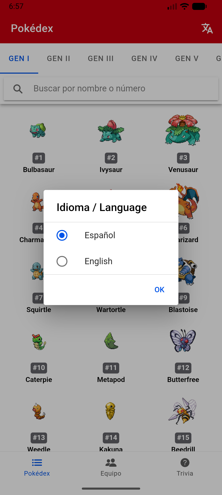 | 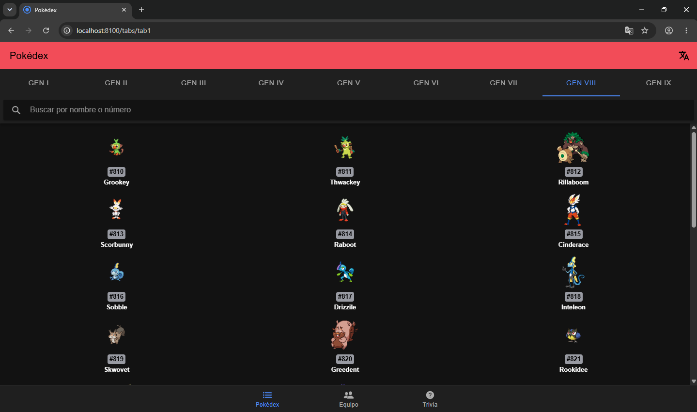 | 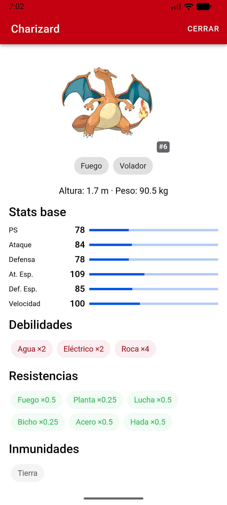 |

| Equipos | Editor de equipo | Editor de Pokémon |
|:---:|:---:|:---:|
| 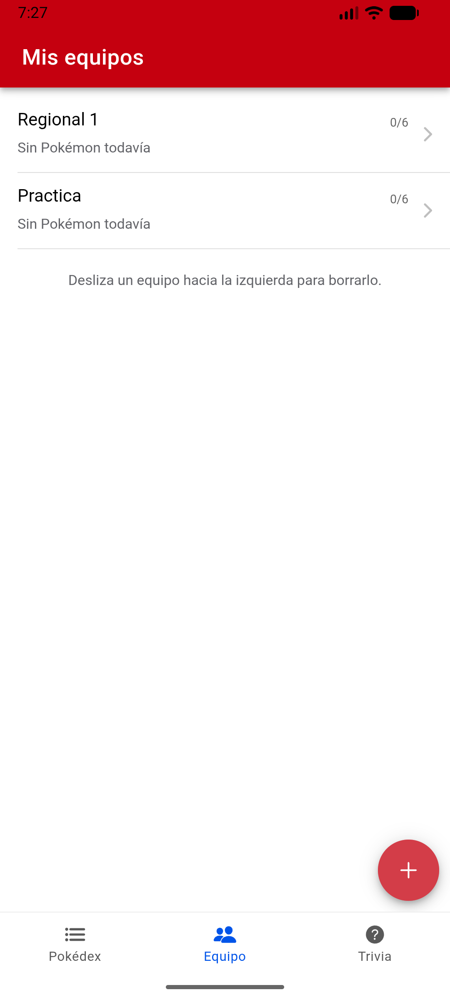 | 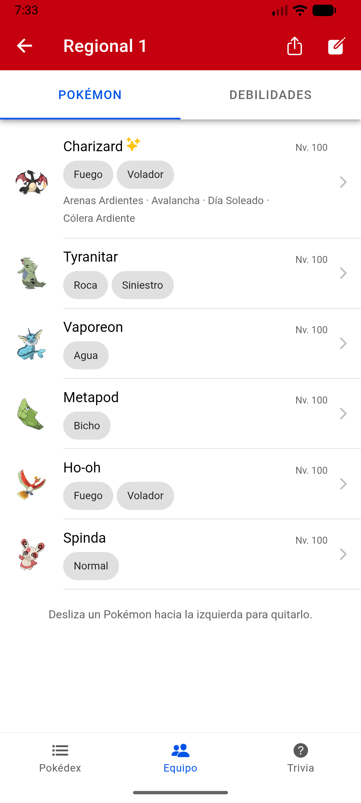 | 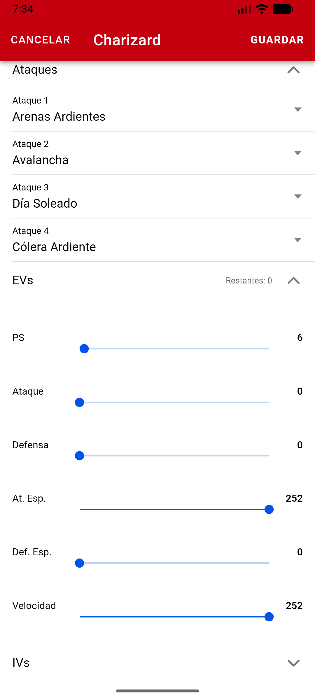 |

| Debilidades | Exportar a Showdown | Trivia |
|:---:|:---:|:---:|
| 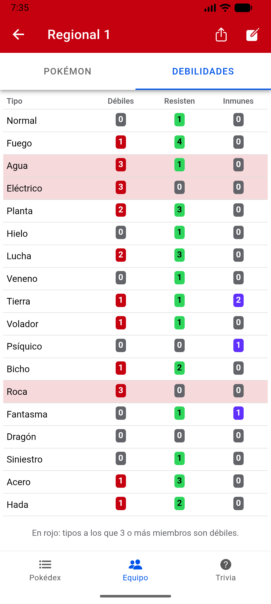 | 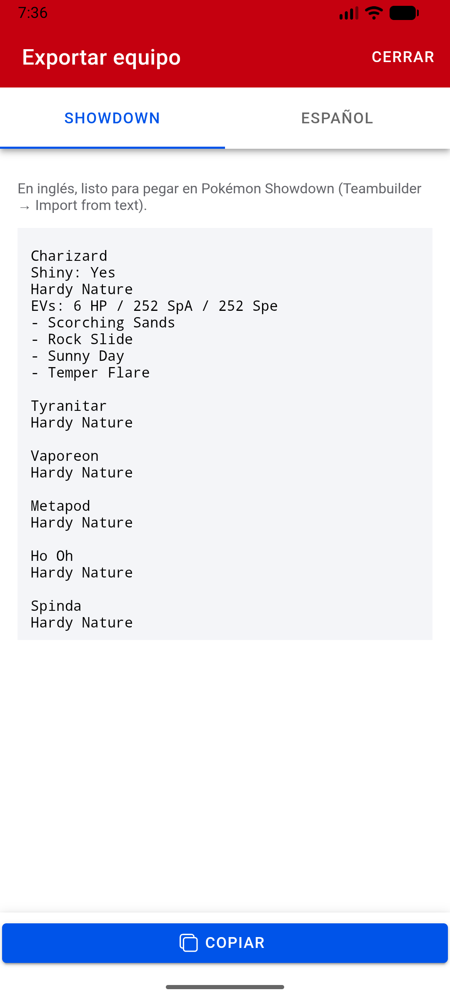 | 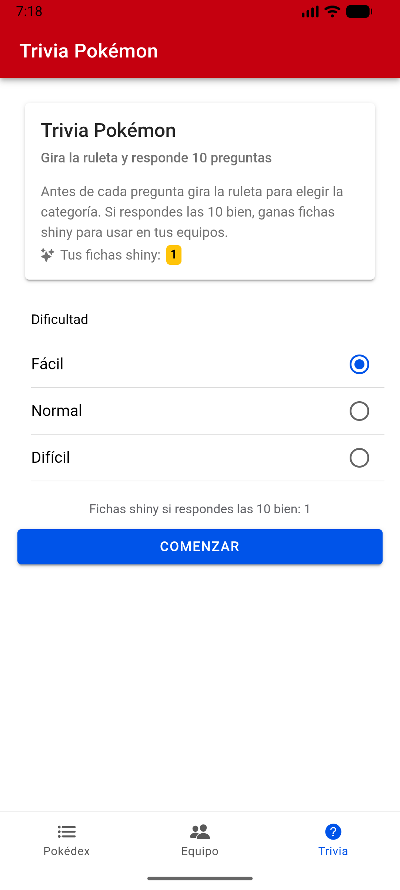 |

| Ruleta | Pregunta | Resultado |
|:---:|:---:|:---:|
| 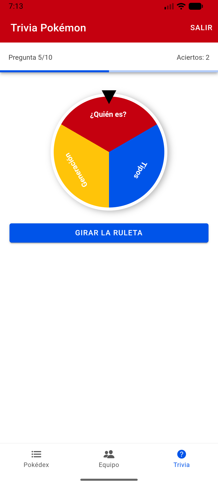 | 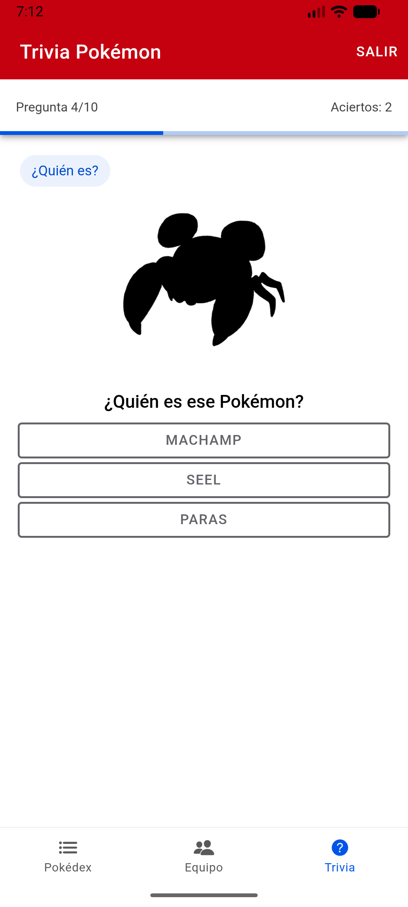 | 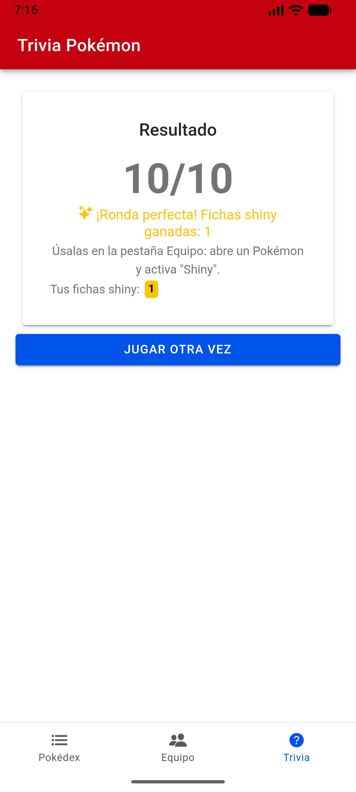 |

## Uso de inteligencia artificial

El uso de IA en este proyecto está documentado en [IA.md](IA.md).